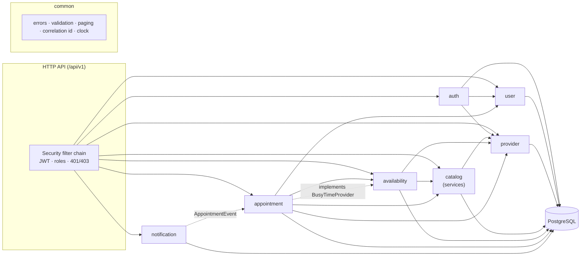
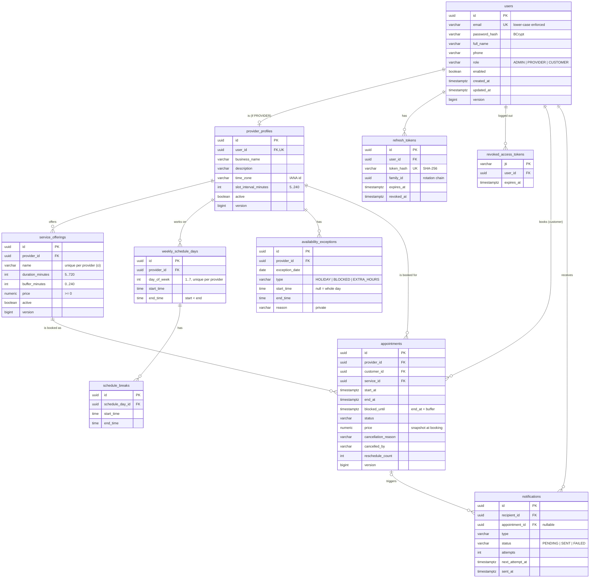
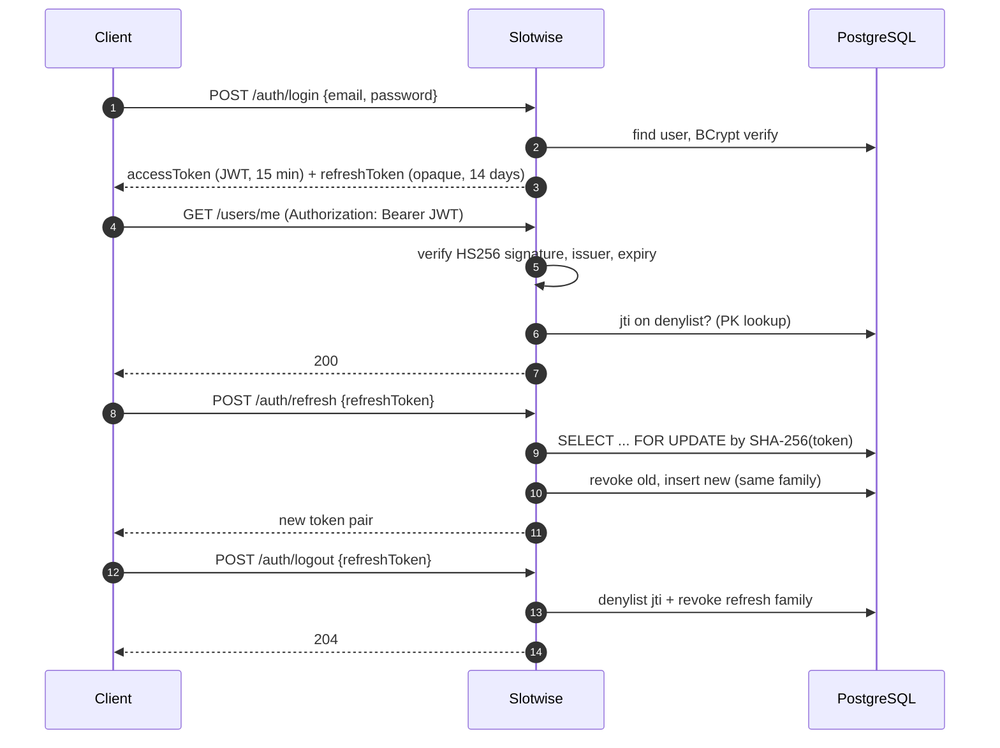
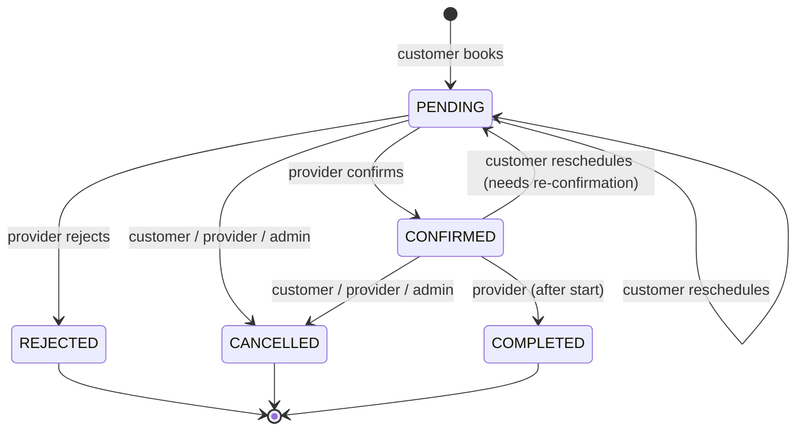
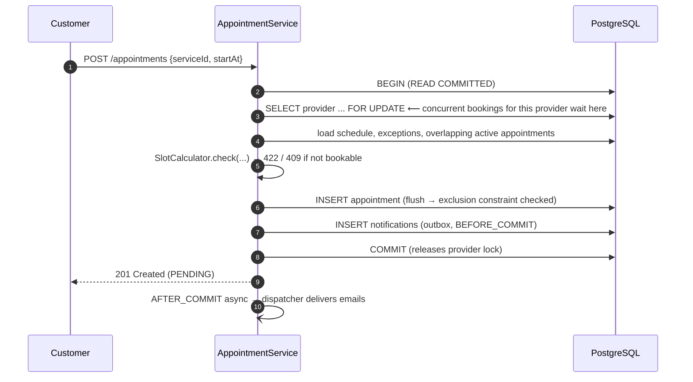

# Slotwise — Appointment Booking & Scheduling API
[](https://github.com/mhzrb/slotwise/actions/workflows/ci.yml)

Slotwise is a backend for booking appointments with service providers such as clinics, salons, tutors and consultants.
Customers discover providers, see real-time availability and book, cancel or reschedule appointments. Providers manage
their services, working hours, breaks, holidays and incoming requests. Administrators oversee users and platform
activity.

It is a **modular monolith** built with Java 21, Spring Boot 4 and PostgreSQL. It focuses on the problems that make
scheduling software hard:

- **No double bookings, even under concurrent load.** A provider-row lock serialises bookings, and a PostgreSQL
  exclusion constraint acts as a safety net. Both are proven by concurrency tests that send parallel requests to a real
  server backed by a real database.
- **Correct time handling.** All timestamps are stored in UTC. Working hours are interpreted in each provider's IANA time
  zone, and slot generation is correct across daylight saving time changes.
- **A real availability engine.** It accounts for weekly schedules, breaks, holidays, partial blocks, extra hours,
  service duration, buffer time, existing appointments, minimum notice and the booking horizon.
- **Production concerns.** JWT access tokens plus rotating refresh tokens with reuse detection, role- and
  ownership-based authorization, RFC 9457 error responses, correlation IDs, a transactional-outbox notification
  pipeline, Flyway migrations, Docker and CI.

---

## Contents

1. [Main features](#1-main-features)
2. [Technology stack](#2-technology-stack)
3. [Architecture overview](#3-architecture-overview)
4. [Project structure](#4-project-structure)
5. [Database design & ER diagram](#5-database-design)
6. [Authentication & authorization](#6-authentication--authorization)
7. [Appointment booking workflow](#7-appointment-booking-workflow)
8. [Concurrency-control strategy](#8-concurrency-control-strategy)
9. [Notifications](#9-notifications)
10. [API documentation](#10-api-documentation)
11. [Example requests & responses](#11-example-requests--responses)
12. [Running locally with Docker](#12-running-locally-with-docker)
13. [Testing](#13-testing)
14. [Configuration reference](#14-configuration-reference)
15. [Future improvements](#15-future-improvements)

---

## 1. Main features

| Area | Capabilities |
|---|---|
| **Accounts** | Registration (customer or provider), login, token refresh with rotation, logout with token revocation, profile and password management, bootstrap admin |
| **Providers** | Public directory with search; self-managed profile (business name, IANA time zone, slot interval, visibility) |
| **Services** | CRUD with ownership checks; duration, buffer time, price, active flag; soft delete; public search by text, price, duration and provider |
| **Availability** | Weekly hours per weekday, breaks, holidays, full or partial blocked dates, temporary extra hours; slot calculation |
| **Appointments** | Book, view history and details, cancel, reschedule (customer); confirm, reject, cancel, complete, daily and weekly agenda (provider); platform-wide search (admin) |
| **Rules** | State machine; minimum notice and booking horizon; customer cancellation and reschedule cutoffs; maximum reschedules. All configurable. |
| **Notifications** | Outbox-based email notifications for created, request-received, confirmed, rejected, cancelled, rescheduled and completed events; async delivery with retries |
| **Operations** | Swagger UI, health probes, correlation IDs, structured logs without secrets, Docker Compose, GitHub Actions |

## 2. Technology stack

| Concern | Choice |
|---|---|
| Language / runtime | Java 21 |
| Framework | Spring Boot 4.1 (Spring Framework 7, Spring Security 7) |
| Web | Spring Web MVC, Bean Validation, Jackson 3 |
| Security | Spring Security OAuth2 Resource Server (Nimbus JOSE, HS256 JWT), BCrypt |
| Persistence | Spring Data JPA, Hibernate 7, PostgreSQL 16, Flyway 12 |
| API docs | springdoc-openapi 3 (OpenAPI 3.1, Swagger UI) |
| Testing | JUnit 5, Mockito, AssertJ, Spring Boot Test, MockMvc, Testcontainers 2 (PostgreSQL), JaCoCo |
| Build / delivery | Maven, Docker (multi-stage, layered), Docker Compose, GitHub Actions |

Dependencies are deliberately minimal. There is no Lombok, MapStruct or third-party JWT library: DTOs are Java records,
mapping is explicit, and JWT handling uses Spring Security's own resource server.

## 3. Architecture overview

Slotwise is a **modular monolith**: one deployable unit, divided into business modules with explicit dependencies.
Each module follows the same layering:

```
module/
  web/       REST controllers + request/response DTOs (records). No business logic.
  service/   Use cases, transactions, authorization-by-ownership, business rules.
  domain/    JPA entities (behaviour, no public setters), enums, repositories.
```



Design decisions worth highlighting:

- **No dependency cycles.** The availability engine needs to know which time is taken, and appointments need the
  availability engine. The availability module therefore defines a `BusyTimeProvider` port, and the appointment module
  implements it (dependency inversion). Further busy-time sources, such as external calendar sync, could be added
  without touching the engine.
- **A pure scheduling core.** `SlotCalculator` has no Spring or database dependencies. All inputs (rules, exceptions,
  busy intervals, the clock-derived bounds) are passed in, which makes the trickiest logic exhaustively unit-testable,
  including DST.
- **Listing and booking can never disagree.** The slot list and booking validation use the same calculator function.
- **Events decouple side effects.** The appointment service publishes `AppointmentEvent`s. The notification module
  listens and writes outbox rows, and the appointment module knows nothing about email.
- **One injectable `Clock`.** Every time-based rule (notice, cutoffs, horizon, token expiry) is testable without
  sleeping.
- **Entities are never exposed.** Controllers map entities to records. `open-in-view` is disabled, and lazy
  associations are fetched explicitly with entity graphs.

## 4. Project structure

```
slotwise/
├── .github/workflows/ci.yml          # build, test (incl. Testcontainers), reports, Docker image
├── Dockerfile                        # multi-stage, layered, non-root, healthcheck
├── docker-compose.yml                # PostgreSQL + app
├── .env.example                      # configuration template (copy to .env)
├── docs/adr/                         # architecture decision records
│   ├── 0001-concurrency-safe-booking.md
│   └── 0002-notification-outbox.md
├── pom.xml
└── src
    ├── main
    │   ├── java/com/slotwise
    │   │   ├── SlotwiseApplication.java
    │   │   ├── auth/             # registration, login, JWT, refresh tokens, security config
    │   │   ├── user/             # user entity, profile, admin user management
    │   │   ├── provider/         # provider profiles, provider lock
    │   │   ├── catalog/          # services offered by providers
    │   │   ├── availability/     # schedules, exceptions, slot engine (engine/ is framework-free)
    │   │   ├── appointment/      # booking, lifecycle state machine, agenda, admin search
    │   │   ├── notification/     # outbox, composer, dispatcher, EmailSender abstraction
    │   │   └── common/           # error handling, validation, paging, correlation id, config
    │   └── resources
    │       ├── application.yml
    │       ├── logback-spring.xml
    │       └── db/migration/     # Flyway V1..V5 (one per module)
    └── test/java/com/slotwise     # mirrors main; *Test = unit, *IT = integration (Testcontainers)
        ├── concurrency/ConcurrentBookingIT.java
        ├── security/AuthorizationMatrixIT.java
        └── support/              # shared Testcontainers base class, HTTP test client
```

## 5. Database design

The schema is owned by **Flyway** (`src/main/resources/db/migration`, one migration per module). Hibernate only
*validates* it (`ddl-auto=validate`) and never generates it.

Conventions:
- UUID primary keys, so IDs are not enumerable through the API.
- Every `created_at`/`updated_at` column is `timestamptz`, written in UTC.
- Optimistic-locking `version` columns on mutable aggregates.
- Enumerations are stored as text, protected by `CHECK` constraints.
- Business invariants are duplicated as database constraints wherever practical.



**Key constraints and indexes**

| Object | Purpose |
|---|---|
| `ex_appointments_no_overlap`: `EXCLUDE USING gist (provider_id WITH =, tstzrange(start_at, blocked_until, '[)') WITH &&) WHERE status IN ('PENDING','CONFIRMED')` | The database itself refuses overlapping active appointments for a provider (see §8) |
| `ck_appointments_time_order` | `start_at < end_at <= blocked_until` |
| `uk_service_offerings_provider_name` on `(provider_id, lower(name))` | No duplicate service names per provider |
| `uk_weekly_schedule_days_provider_day` | One schedule row per weekday |
| `ck_availability_exceptions_*` | HOLIDAY has no times, EXTRA_HOURS requires times, and times are either both set or both absent |
| `idx_appointments_provider_start`, `idx_appointments_customer_start` | Agenda and history queries |
| `idx_notifications_pending` (partial: `WHERE status = 'PENDING'`) | Cheap outbox polling |
| `uk_refresh_tokens_hash` | Constant-time token lookup |

`DatabaseSchemaIT` tests these constraints directly with SQL, independent of the application code.

## 6. Authentication & authorization



- **Passwords** are hashed with BCrypt via a `DelegatingPasswordEncoder` (`{bcrypt}` prefix, so the algorithm can be
  upgraded later). The password policy is 8–72 characters, at least one letter and one digit; 72 is BCrypt's input limit.
- **Access tokens** are HS256 JWTs carrying `sub` (the user ID), `role`, `jti`, `iat`, `exp` and `iss`, and no
  personal data. They expire after 15 minutes. The signing key comes from `JWT_SECRET`, and the application refuses to
  start if the key is missing or shorter than 32 bytes.
- **Refresh tokens** are 256-bit random opaque values. Only their SHA-256 hash is stored, and they are single use: every
  refresh rotates the token. **Reuse detection:** presenting an already-rotated token revokes its whole family, which
  signals token theft. Concurrent refreshes are serialised with a row lock.
- **Logout** denylists the access token's `jti` until it expires and revokes the session's refresh tokens. Other
  sessions stay valid. Changing your password or being disabled by an admin revokes all refresh tokens.
- **Timing-safe login.** Unknown emails still go through a BCrypt comparison, and both failure cases return the same
  message, so attackers cannot enumerate accounts.

**Authorization happens in two layers.**

1. **Roles, in the security filter chain** (`SecurityConfig`), before any request body is read. A wrong role always gets
   `403`, never a `400` that would reveal validation details. `@PreAuthorize` on controllers repeats the role checks as
   defence in depth.
2. **Ownership, in the service layer**, where the resource is known:
   - Customers can only see and change their own appointments.
   - Providers can only manage their own services, availability and appointments, and cannot see other providers'
     private data. Public provider views omit owner email, user ID and status; exception reasons are private.
   - Admins can access everything under `/api/v1/admin/**`.

`AuthorizationMatrixIT` calls 27 protected endpoints anonymously and as each of the three roles (108 checks), and
asserts the expected 401, 403 or allowed outcome for every combination.

## 7. Appointment booking workflow

**State machine**



Invalid transitions return `409 INVALID_STATUS_TRANSITION`. The complete 5×5 transition table is unit-tested.

**Business rules (all configurable, see §14)**

| Rule | Default | Error |
|---|---|---|
| No booking in the past | — | `422 BOOKING_IN_PAST` |
| Minimum notice | 1 h | `422 BOOKING_TOO_SOON` |
| Booking horizon | 90 days | `422 BOOKING_TOO_FAR_AHEAD` |
| The start must be an offered slot (working hours, not on a break or exception, aligned to the slot interval, and the service must fit before the window ends) | — | `422 SLOT_NOT_OFFERED` |
| No overlap with active appointments, buffer included | — | `409 SLOT_UNAVAILABLE` |
| Customer cancellation cutoff | 24 h before start | `422 CANCELLATION_WINDOW_CLOSED` |
| Customer reschedule cutoff / maximum reschedules | 24 h / 3 | `422 RESCHEDULE_WINDOW_CLOSED` / `RESCHEDULE_LIMIT_REACHED` |
| Started appointments cannot be cancelled; only started ones can be completed | — | `422 APPOINTMENT_ALREADY_STARTED` / `APPOINTMENT_NOT_STARTED` |

Providers may cancel within the customer cutoff, for example because of illness. Rescheduling keeps the originally
booked duration and buffer, and the price is snapshotted at booking time.

**How slots are calculated** (`availability/engine/SlotCalculator`), for each provider-local date:

1. A HOLIDAY or full-day BLOCKED exception means no availability that day.
2. Take the weekly hours for that weekday and remove its breaks.
3. Merge in any EXTRA_HOURS windows.
4. Remove any partial BLOCKED windows.
5. Convert each local window to UTC instants in the provider's zone. Candidates step every `slotIntervalMinutes` of
   real elapsed time, while `start + duration ≤ windowEnd`.
6. Drop candidates before `now + minNotice` or after `now + horizon`, and candidates whose occupied range
   `[start, start + duration + buffer)` overlaps an existing active appointment.

**DST:**
- On spring-forward days, a local time that doesn't exist is never offered.
- On fall-back days, the repeated hour is offered twice, with distinct UTC instants and offsets.
- A 60-minute service always lasts 60 real minutes.

Both transitions are covered by unit tests using `America/Toronto` 2030 dates.

**Booking sequence**



## 8. Concurrency-control strategy

> The full reasoning, alternatives and trade-offs are in
> [`docs/adr/0001-concurrency-safe-booking.md`](docs/adr/0001-concurrency-safe-booking.md).

**Problem.** If two customers request the same or overlapping times at the same moment, "check availability, then
insert" is a race: both checks pass and both inserts succeed. Overlaps are a range problem, so a `UNIQUE (provider_id,
start_at)` constraint cannot catch them.

**Solution: two independent layers.**

1. **Pessimistic row lock (the primary mechanism).** Booking and rescheduling lock the provider's row with
   `SELECT … FOR UPDATE` before re-validating the slot, inside one `READ COMMITTED` transaction.
   - Requests for the same provider queue up and run one at a time. Because READ COMMITTED takes a fresh snapshot for
     each statement, the second request's availability check sees the first one's committed appointment and gets a
     clean `409`.
   - Different providers never block each other.
   - Schedule edits take the same lock.
   - Lock waits are capped by `lock_timeout` (5 s). Exceeding it returns `503` with `Retry-After` rather than hanging.
2. **Exclusion constraint (the safety net).** `EXCLUDE USING gist (provider_id WITH =, tstzrange(start_at,
   blocked_until) WITH &&) WHERE status IN ('PENDING','CONFIRMED')` makes overlaps physically impossible, whatever code
   path writes the row. Buffers are included, and half-open ranges allow back-to-back appointments. Inserts are flushed
   inside the transaction, and SQLSTATE `23P01` maps to `409`.

**Why not just one of them?**
- **SERIALIZABLE alone** requires retry loops and aborts more transactions than necessary.
- **Optimistic locking alone** doesn't work: a new appointment has no existing row to version.
- **The constraint alone** is correct, but the concurrency tests showed that simultaneous conflicting inserts can then
  deadlock (`40P01`) or hit `lock_timeout` (`55P03`) while each transaction waits on the other's uncommitted row. Taking
  the lock first prevents that on every application path.

**Evidence.** `ConcurrentBookingIT` drives the real HTTP server on a random port, backed by real PostgreSQL, releasing
many threads at the same instant through a start gate:

| Scenario | Asserted result |
|---|---|
| 12 customers, one slot (repeated 5×) | exactly 1 × `201`, 11 × `409`; one active row; no overlaps |
| Different overlapping start times (10:00/10:15/10:30/10:45, 60-min service) | exactly 1 succeeds |
| Conflicts caused only by buffer time | respected under concurrency |
| 8 non-overlapping bookings for one provider at once | all 8 succeed (the lock never rejects valid work) |
| 4 providers × 2 contenders | exactly 1 winner per provider |
| A reschedule and a new booking racing for one slot | exactly 1 wins |
| A confirm and a reject racing on one appointment | exactly 1 applies (optimistic lock or state machine) |
| Raw concurrent SQL inserts that bypass the app (repeated 3×) | the constraint alone lets exactly 1 commit |
| The provider row held locked by another transaction | `503 LOCK_TIMEOUT` within the timeout, then success once released |

After each scenario an independent SQL self-join asserts that no two active appointments of a provider overlap.

## 9. Notifications

> Details: [`docs/adr/0002-notification-outbox.md`](docs/adr/0002-notification-outbox.md)

Notifications use a **transactional outbox**:

- **Writing.** A `BEFORE_COMMIT` listener inserts `notifications` rows in the same transaction as the appointment
  change. A rolled-back booking (for example a lost race) produces no notification, and a committed one always has its
  notification.
- **Delivering.** A dispatcher runs every 5 s on a scheduler thread, and is also triggered asynchronously right after
  commit. It claims due rows with `FOR UPDATE SKIP LOCKED`, so several threads or instances can run safely, and sends
  them through the `EmailSender` interface.
- **Failure handling.** A failed send never affects the appointment. It is retried with exponential backoff
  (1 m, 2 m, 4 m, …) and marked `FAILED` after 5 attempts.
- **Development sender.** The default `LoggingEmailSender` logs a masked recipient (`a***@example.com`) and the subject;
  the body is logged only at DEBUG. To send real email, implement `EmailSender` (SMTP, SES, …).
- **Inspection.** Users can see their notifications at `GET /api/v1/notifications/me`.

## 10. API documentation

When the app is running:
- **Swagger UI:** <http://localhost:8080/swagger-ui.html>
- **OpenAPI JSON:** <http://localhost:8080/v3/api-docs>

Set `API_DOCS_ENABLED=false` to turn both off in production.

All endpoints are versioned under `/api/v1`. List endpoints support `page`, `size` (max 100) and `sort` (whitelisted
properties only), plus endpoint-specific filters.

| Method | Path | Access | Description |
|---|---|---|---|
| POST | `/auth/register` | public | Register a customer (default) or provider (`businessName`, `timeZone` required) |
| POST | `/auth/login` | public | Get an access + refresh token |
| POST | `/auth/refresh` | public | Rotate the refresh token, get a new pair |
| POST | `/auth/logout` | authenticated | Revoke the access token and the session's refresh tokens |
| GET / PUT | `/users/me` | authenticated | Own profile |
| PUT | `/users/me/password` | authenticated | Change password (revokes refresh tokens) |
| GET | `/providers?q=` | public | Search active providers |
| GET | `/providers/{providerId}` | public | Public provider details |
| GET / PUT | `/providers/me` | PROVIDER | Own provider profile (time zone, slot interval, active) |
| POST / GET | `/providers/me/services` | PROVIDER | Create / list own services (including inactive) |
| GET | `/providers/{providerId}/services` | public | A provider's active services |
| GET | `/services?q=&providerId=&maxPrice=&maxDurationMinutes=` | public | Search services |
| GET | `/services/{serviceId}` | public | Service details |
| PUT / DELETE | `/services/{serviceId}` | PROVIDER (owner) | Update / deactivate (soft delete) |
| PUT / GET | `/providers/me/availability` | PROVIDER | Replace / view the weekly schedule and breaks |
| POST / GET | `/providers/me/availability/exceptions` | PROVIDER | Add / list holidays, blocks, extra hours |
| DELETE | `/providers/me/availability/exceptions/{id}` | PROVIDER (owner) | Remove an exception |
| GET | `/providers/{providerId}/availability?from=&to=` | public | Weekly schedule and exceptions (without reasons) |
| GET | `/providers/{providerId}/slots?serviceId=&from=&to=` | public | Bookable slots (provider-local dates, ≤ 31 days) |
| POST | `/appointments` | CUSTOMER | Book |
| GET | `/appointments/me?status=&from=&to=` | CUSTOMER | Own history |
| GET | `/appointments/{id}` | owner customer, owner provider, ADMIN | Details |
| PATCH | `/appointments/{id}/cancel` | CUSTOMER / PROVIDER / ADMIN | Cancel (role-specific rules) |
| PATCH | `/appointments/{id}/reschedule` | CUSTOMER (owner) | Move to another slot |
| PATCH | `/appointments/{id}/confirm` · `/reject` · `/complete` | PROVIDER (owner) | Lifecycle transitions |
| GET | `/providers/me/appointments?status=&from=&to=` | PROVIDER | Appointments booked with me |
| GET | `/providers/me/schedule?date=&view=DAY\|WEEK` | PROVIDER | Agenda grouped by local date |
| GET | `/notifications/me` | authenticated | Own notifications |
| GET | `/admin/users?role=&enabled=&q=` | ADMIN | Search users |
| GET | `/admin/users/{id}` | ADMIN | User details |
| PATCH | `/admin/users/{id}/status` | ADMIN | Enable / disable a user |
| GET | `/admin/appointments?providerId=&customerId=&status=&from=&to=` | ADMIN | Search all appointments |
| GET | `/actuator/health` | public | Liveness / readiness |

These intentionally differ from the suggested endpoint list. Status changes are separate `PATCH` sub-resources (one
intent per call, each with its own rules). `DELETE /services/{id}` deactivates rather than removes, so historical
appointments keep their service. Provider self-management lives under `/providers/me/**`.

**Error format.** Every error, including 401/403 from the security layer and framework errors such as 404/405/415, is
an RFC 9457 Problem Details document. It carries a stable machine-readable `code`, the request's `correlationId` and,
for validation errors, field-level `errors`. Send an `X-Correlation-Id` header to propagate your own trace ID; it is
echoed back and appears in every log line for that request.

## 11. Example requests & responses

The responses below were captured from the Docker Compose deployment. Tokens are truncated.

**Register a provider**

```bash
curl -X POST localhost:8080/api/v1/auth/register -H 'Content-Type: application/json' -d '{
  "email": "dr.smith@example.com", "password": "Secret123", "fullName": "Dana Smith",
  "role": "PROVIDER", "businessName": "Smith Physiotherapy", "timeZone": "America/Toronto" }'
```
```json
{
  "accessToken": "eyJraWQiOiJVWGtDTkVN...",
  "refreshToken": "4fUc3clrX-...",
  "tokenType": "Bearer",
  "expiresIn": 900,
  "user": {
    "id": "2b1159fe-afc6-4b38-803b-fb6727b34f9b",
    "email": "dr.smith@example.com",
    "fullName": "Dana Smith",
    "role": "PROVIDER",
    "enabled": true,
    "createdAt": "2026-11-26T23:18:55.024588252Z"
  }
}
```

**Define working hours and a service** (provider token)

```bash
curl -X PUT localhost:8080/api/v1/providers/me/availability -H "Authorization: Bearer $PROVIDER_TOKEN" \
  -H 'Content-Type: application/json' -d '{ "days": [
    { "dayOfWeek": "MONDAY",    "startTime": "09:00", "endTime": "17:00", "breaks": [{ "startTime": "12:00", "endTime": "13:00" }] },
    { "dayOfWeek": "WEDNESDAY", "startTime": "09:00", "endTime": "17:00", "breaks": [{ "startTime": "12:00", "endTime": "13:00" }] } ] }'

curl -X POST localhost:8080/api/v1/providers/me/services -H "Authorization: Bearer $PROVIDER_TOKEN" \
  -H 'Content-Type: application/json' \
  -d '{ "name": "Initial Assessment", "durationMinutes": 60, "bufferMinutes": 15, "price": 95.00 }'
```

**Find slots** (public; dates are provider-local)

```bash
curl "localhost:8080/api/v1/providers/$PROVIDER_ID/slots?serviceId=$SERVICE_ID&from=2026-12-16&to=2026-12-16"
```
```json
{
  "timeZone": "America/Toronto",
  "durationMinutes": 60,
  "slots": [
    { "startAt": "2026-12-16T14:00:00Z", "endAt": "2026-12-16T15:00:00Z",
      "localStart": "2026-12-16T09:00:00-05:00", "localEnd": "2026-12-16T10:00:00-05:00" },
    { "startAt": "2026-12-16T14:15:00Z", "endAt": "2026-12-16T15:15:00Z",
      "localStart": "2026-12-16T09:15:00-05:00", "localEnd": "2026-12-16T10:15:00-05:00" }
  ]
}
```

**Book** (customer token) returns `201 Created` with a `Location` header

```bash
curl -X POST localhost:8080/api/v1/appointments -H "Authorization: Bearer $CUSTOMER_TOKEN" \
  -H 'Content-Type: application/json' \
  -d '{ "serviceId": "62ca9f59-…", "startAt": "2026-12-16T14:00:00Z", "notes": "Lower back pain" }'
```
```json
{
  "id": "aec3e3bb-589d-4fd7-b1da-4cf7342c1675",
  "status": "PENDING",
  "startAt": "2026-12-16T14:00:00Z",
  "endAt": "2026-12-16T15:00:00Z",
  "localStartAt": "2026-12-16T09:00:00-05:00",
  "localEndAt": "2026-12-16T10:00:00-05:00",
  "timeZone": "America/Toronto",
  "service": { "id": "62ca9f59-9d40-4e41-9962-c13b0d94b075", "name": "Initial Assessment", "durationMinutes": 60 },
  "provider": { "id": "660c7881-f674-4003-aa12-1bcd44fbacc3", "businessName": "Smith Physiotherapy" },
  "customer": { "id": "4aaaacde-f25c-4056-9b9c-8bb42cb1621a", "fullName": "Alex Rivera", "email": "alex@example.com" },
  "price": 95.00,
  "notes": "Lower back pain",
  "rescheduleCount": 0,
  "createdAt": "2026-11-26T23:18:55.577951693Z",
  "updatedAt": "2026-11-26T23:18:55.577951693Z"
}
```

**Another customer books the same slot:** `409 Conflict`

```json
{
  "title": "Conflict",
  "status": 409,
  "detail": "The requested time slot is no longer available",
  "instance": "/api/v1/appointments",
  "code": "SLOT_UNAVAILABLE",
  "timestamp": "2026-11-26T23:18:55.777830240Z",
  "correlationId": "aef40c18-9de9-4373-8bbb-7a64ed368bb9"
}
```

**Validation error:** `400 Bad Request`

```json
{
  "title": "Bad Request",
  "status": 400,
  "detail": "Request validation failed",
  "instance": "/api/v1/auth/register",
  "code": "VALIDATION_FAILED",
  "timestamp": "2026-11-26T23:18:55.924062642Z",
  "correlationId": "02480b39-4de5-425e-ba99-d09edaf2f9e9",
  "errors": [
    { "field": "password", "message": "must contain at least one letter and one digit" },
    { "field": "fullName", "message": "must not be blank" },
    { "field": "email", "message": "must be a well-formed email address" },
    { "field": "password", "message": "size must be between 8 and 72" }
  ]
}
```

**Provider workflow**

```bash
curl -X PATCH localhost:8080/api/v1/appointments/$ID/confirm -H "Authorization: Bearer $PROVIDER_TOKEN"
curl "localhost:8080/api/v1/providers/me/schedule?date=2026-12-14&view=WEEK" -H "Authorization: Bearer $PROVIDER_TOKEN"
```

## 12. Running locally with Docker

Prerequisites: Docker with Compose v2.

```bash
cp .env.example .env
```

Edit `.env`: set `POSTGRES_PASSWORD`, a `JWT_SECRET` (for example the output of `openssl rand -base64 48`) and,
optionally, `ADMIN_EMAIL` / `ADMIN_PASSWORD` for a bootstrap administrator. Then start the stack:

```bash
docker compose up --build
```

The app waits for PostgreSQL to become healthy, applies the Flyway migrations, and listens on
<http://localhost:8080> (Swagger UI at `/swagger-ui.html`). The container runs as a non-root user and has a
readiness healthcheck.

To stop the stack (add `-v` to also delete the database volume):

```bash
docker compose down
```

**Without Docker for the app** (JDK 21 + a PostgreSQL 16 instance):

```bash
DB_URL=jdbc:postgresql://localhost:5432/slotwise DB_USERNAME=slotwise DB_PASSWORD=... JWT_SECRET=... ./mvnw spring-boot:run
```

The Maven wrapper (`./mvnw`) downloads the pinned Maven version, so a local Maven install isn't needed. Add
`SPRING_PROFILES_ACTIVE=dev` for DEBUG logging, which includes notification bodies.

**Behind a TLS-intercepting corporate proxy**, the image build can trust extra CA certificates (build stage only):

```bash
docker build --secret id=ca,src=corporate-ca-bundle.pem -t slotwise .
```

## 13. Testing

```bash
./mvnw verify
```

`./mvnw verify` runs everything: unit tests (Surefire, `*Test`) and integration tests (Failsafe, `*IT`). The integration
tests need Docker for Testcontainers.

```bash
./mvnw test
```

`./mvnw test` runs only the fast unit tests and doesn't need Docker. To run a single integration test class:

```bash
./mvnw verify -Dit.test=ConcurrentBookingIT
```

The coverage report (unit and integration runs merged) is written to `target/site/jacoco/index.html`.

**Strategy**

| Layer | What it covers | Examples |
|---|---|---|
| Unit (Mockito / plain JUnit) | Business rules in isolation, without Spring | `SlotCalculatorTest` (hours, breaks, exceptions, buffers, notice and horizon, **DST**), `AppointmentStatusTest` (full transition table), `AppointmentServiceTest` (cutoffs, ownership, lock-before-check ordering), `AuthServiceTest`, `RefreshTokenServiceTest` (rotation, reuse detection), `NotificationComposerTest`, validation tests |
| Integration (Spring Boot + MockMvc + **real PostgreSQL**) | Full HTTP stack: security, validation, JSON, transactions, SQL | `AuthIT`, `UserManagementIT`, `ProviderIT`, `ServiceManagementIT`, `AvailabilityIT`, `AppointmentLifecycleIT`, `NotificationIT`, `PlatformIT` |
| Security | Role matrix for every protected endpoint | `AuthorizationMatrixIT` |
| Database | Constraints exercised directly with SQL | `DatabaseSchemaIT` |
| Concurrency (real server, parallel HTTP) | Double-booking prevention and database consistency under races | `ConcurrentBookingIT`, `NotificationIT` (parallel dispatchers) |

- **Containers.** One PostgreSQL container is shared by all integration tests (singleton pattern, so the Spring
  context cache stays valid).
- **Isolation.** Every test starts from truncated tables, so tests are independent and can run in any order.
- **Determinism.** Time-dependent rules use an injected `Clock`. Tests pick dates relative to "now" so they never
  expire, and the notification dispatcher is triggered explicitly in tests.

## 14. Configuration reference

All settings are environment variables, with defaults in `application.yml`.

| Variable | Default | Meaning |
|---|---|---|
| `DB_URL`, `DB_USERNAME`, `DB_PASSWORD` | `jdbc:postgresql://localhost:5432/slotwise`, `slotwise`, — | Database |
| `DB_POOL_SIZE` | `20` | Hikari pool size |
| `DB_LOCK_TIMEOUT` | `5s` | Maximum wait for a row lock (exceeding it returns `503`) |
| `JWT_SECRET` | — (**required**, ≥ 32 bytes) | HS256 signing key |
| `JWT_ACCESS_TOKEN_TTL` / `JWT_REFRESH_TOKEN_TTL` | `15m` / `14d` | Token lifetimes |
| `ADMIN_EMAIL`, `ADMIN_PASSWORD` | — | Bootstrap admin, created at startup if missing |
| `BOOKING_MIN_NOTICE` | `1h` | Earliest bookable time relative to now |
| `BOOKING_MAX_HORIZON` | `90d` | Latest bookable time relative to now |
| `BOOKING_CANCELLATION_CUTOFF` | `24h` | Customer cancellation deadline before the start time |
| `BOOKING_RESCHEDULE_CUTOFF` | `24h` | Customer reschedule deadline before the start time |
| `BOOKING_MAX_RESCHEDULES` | `3` | Reschedules allowed per appointment |
| `NOTIFICATIONS_DISPATCH_ENABLED` | `true` | Background delivery on or off |
| `NOTIFICATIONS_EMAIL_SENDER` | `log` | `log` = development sender |
| `API_DOCS_ENABLED` | `true` | Swagger UI / OpenAPI on or off |

## 15. Future improvements

- **Rate limiting and brute-force protection** on `/auth/login` and `/auth/register`, for example per-IP and
  per-account throttling with lockout.
- **Asymmetric JWT signing (RS256/ES256) with a JWKS endpoint**, so other services can verify tokens without sharing a
  secret, plus key rotation.
- **Immediate effect of account disablement** on outstanding access tokens. They currently stay valid until they expire,
  at most 15 minutes. A short-lived cache of disabled user IDs, checked by the token validator, would close the gap.
- **Real email delivery** (SMTP/SES) with templates and localisation. Also a claim-then-send outbox step for slow
  providers, and a retention job for old notifications.
- **Customer-local time display.** Times are currently shown in the provider's zone, where the appointment happens.
- **Multi-staff providers and resources** (rooms, equipment), locking per resource instead of per provider.
- **Working windows that end at 24:00 or cross midnight**, which `LocalTime` ranges can't currently express.
- **A warning when a schedule change leaves existing appointments outside the new working hours.**
- **Payments and deposits, no-show tracking, waitlists, recurring appointments, calendar (iCal) export.**
- **Observability:** Micrometer metrics (booking conflicts, lock waits, outbox lag), OpenTelemetry tracing, and JSON
  logs for log aggregation.
- **Trigram or full-text indexes** for catalogue search at larger scale.
- **Mutation testing** (PIT) and architecture tests (ArchUnit) to enforce the module dependency rules automatically.
